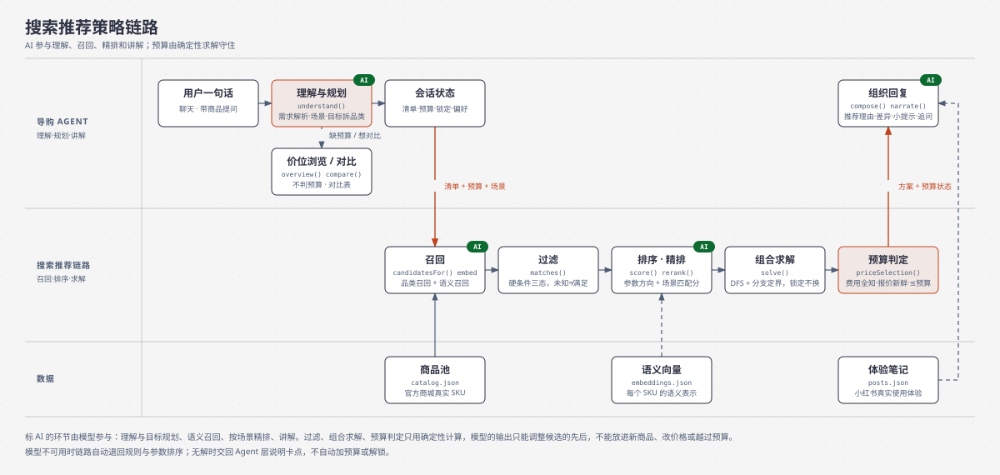

# 知选：预算导购

> 本仓库暂时用于展示个人项目「知选」，内容同步自开发仓库 2026-11-03 版本（`bcaa7d3`）。原数据分析作品集已存档在标签 `archive/data-analysis-portfolio-2026-11-03`。

说出用途和预算，知选从真实在售商品里挑一件，或者按总预算配一整套；钱怎么花、花在哪，算得清清楚楚。

线上地址：

- 中国大陆可直接访问：<https://zhixuan.onrender.com>（新加坡）
- 海外：<https://zhixuan-ai-shopping-guide.vercel.app>

## 核心能力

- **一句话说需求就行**：“吹风机和电动牙刷，一共600”“给爸妈各买一个，一个两百以内，加起来不超三百”“预算再多给一百五”，总价、单价、相对调整、数量、品牌偏好和排除、硬条件都能听懂；说法不规范时先改写成标准需求再理解，真看不懂就追问，绝不瞎猜。
- **AI 参与选品，而不只是聊天**：只说目标也能拆出该买哪几样（“出差一周配数码装备，1500以内”），按用途和人群理解需求（“宿舍用、别太吵”“送经常跑步的男朋友”），用语义召回和场景精排把真正合适的商品排到前面，再由求解器按总预算定稿。
- **按总预算配一整套**：多件商品一起求解，按店铺合并运费，整套合计守在预算里，而不是每件各自“看着便宜”。
- **预算是承诺，不是标签**：只有运费、报价全部确认且报价新鲜、合计不超预算时，才说“在预算内”；运费不确定就写“运费以平台为准”，绝不补 0；没解时说明卡在哪，从不悄悄加预算或换掉你锁定的商品。
- **多轮连续改**：加减商品、换一款、锁定、改数量、调预算、只看某一件，每次都在同一个购物车上重新求解。
- **看得见的思考过程**：发出需求后，页面实时展示每一步——读取需求、理解场景、拆解目标、从多少款里召回、语义匹配、场景打分、比较了多少种组合、合计多少——数字全部来自真实执行。
- **像导购一样讲清楚**：先给选购要点，再给最适合你的一款和备选；同类商品可以一键对比（对比表 + 怎么理解差异 + 首选/备选）；带着商品页直接提问；附上小红书真实使用体验。
- **只说有依据的话**：价格来自官方商城当日标价，参数只取商品页写明的内容，没写的标“页面未写”，不当作满足。

## 搜索推荐策略链路

产品需求见 [`docs/prd.md`](docs/prd.md)，链路的接口、校验、参数、哪些话会走模型以及如何确认线上在用模型，见 [`docs/agent-pipeline.md`](docs/agent-pipeline.md)。



整条链路分成两层，AI 参与其中四个环节（理解与规划、语义召回、场景精排、讲解）：**导购 Agent 层**负责听懂需求、维护多轮对话、把结果讲清楚；**搜索推荐链路**负责从商品池里挑出商品并把钱算清楚。过滤、组合求解和预算判定始终是确定性计算：模型给出的任何判断，最后都要经过同一个求解器按总预算重新定稿，所以“买哪几件、合计多少、在不在预算内”永远由规则说了算。模型不可用或超时，链路自动退回规则与参数排序。

### 导购 Agent 层（`lib/nlu.mjs`、`lib/assistant.mjs`、`lib/agent.mjs`）

| 环节 | 做什么 |
|---|---|
| 需求解析 `nlu.understand()` | 规则把一句话解析成结构化需求：品类、子类、数量、预算（总价或单价、相对调整如“再加 100”）、品牌想要与排除、硬条件（如“要带降噪”）、增删改、锁定、视图切换。多个金额先剔除单价和相对调整再认总预算；模糊或冲突时追问，不静默套用。 |
| 场景理解与目标规划 `agent.understand()`（AI） | 读出用途、对象和偏好（“宿舍用、别太吵”→ 场景 + 偏好“安静”）；只说目标没说买什么时拆成品类清单（“出差一周配数码装备”→ 充电宝、耳机、键盘），口语说法改写成标准需求。输出再交给规则解析：预算只认用户原话里的数字，品类只能取商品池里有的。 |
| 会话状态 | 多轮共用一个购物车：商品项、总预算、锁定、偏好。按钮操作（`applyOp()`）直接改购物车，不经过理解。 |
| 价位浏览 `overview()` | 还没给预算时不求解：把品类按价位三等分，“多数人会选”的一档放最前，再给“想省一点”“想要更好的”，用一句话问大概想花多少。只借用召回和排序，不做任何预算判断。 |
| 对比同类 `compareReply()` | 从商品页或当前推荐发起：同品类里价格相近、参数最好的一款，生成对比表（价格、品牌、平台、商品页写明的参数与规格、运费、价格日期），给出首选和备选。 |
| 组织回复 `compose()` / `narrate()` | 把搜索链路的结果讲成人话：选购要点 → 最适合你 → 为什么这么挑 → 备选与升级 → 真实体验笔记 → 小提示和一个帮你缩小范围的追问。所有讲解只能引用商品数据里的数字，预算状态以搜索链路的判定为准。 |
| 商品问答 `answer()` | 带着某件商品提问时，只根据这件商品的数据回答，商品页没写的直接说没写。 |

### 搜索推荐链路（`lib/engine.mjs`、`lib/catalog.mjs`）

| 环节 | 做什么 |
|---|---|
| 召回 `candidatesFor()` + 语义召回（AI） | 按品类从商品池取候选，不跨品类；再用场景描述和每个 SKU 预先算好的语义向量算相似度，把更贴合场景的候选往前提。 |
| 过滤 `matches()` | 排除下架、排除的商品与品牌，检查单价上下限。硬条件三态：满足 / 不满足 / 未知，未知不算满足。 |
| 排序 `score()` + 场景精排 `rerank()`（AI） | 先按参数方向（噪音越低越好、续航越长越好等）加偏好打分；有场景时，模型给每件商品预算内的前几名候选打 0–3 的场景匹配分并写一句依据，折算成加减分（上限 ±400）。精排只能调整已经通过过滤的候选的先后，不能加进新商品。 |
| 组合求解 `solve()` | 多件商品联合深度优先搜索 + 分支定界，按店铺合并运费，锁定的商品不替换。每件保留评分前 40 与最便宜 8 个候选；节点上限 40 万、超时 250ms，超出时标记为未穷尽。 |
| 预算判定 `priceSelection()` | 只有运费与报价全部已知、报价在 14 天内、合计不超过预算，才算“在预算内”；运费未知写“运费以平台为准”，不补 0。无解时不自动放宽预算或解锁。 |

对话与清单每轮保存（本地 SQLite，线上 Supabase）。重新打开对话会按当前商品池重新核价，价格变化只标记过期，不会悄悄换商品。

### 预算约束怎么守住

| 约束 | 做法 |
|---|---|
| 金额精确 | 全程整数分计算，不做浮点运算。 |
| 总价而不是单价 | 多件商品联合求解，合计（含按店铺合并的运费）不超过总预算。 |
| 运费不补 0 | 店铺运费规则不明时整单标“运费以平台为准”，不算作在预算内。 |
| 报价要新鲜 | 报价超过 14 天只作参考，不能确认预算。 |
| 参数缺失不算满足 | 硬条件三态判断，商品页没写的一律按“未知”处理。 |
| 不悄悄改你的决定 | 锁定的商品不替换；无解时只给可选调整，不自动加预算、不解锁；“按单品看”只换视图，购物车和预算都不变。 |
| 讲解不越权 | Agent 层写的每句话都要过校验：数字必须出自商品数据，不能用无依据的宣传词，搜索链路没判定在预算内就不能这么说。 |

这些规则由 `bench/` 的 193 条多轮对话基准逐条验证（12 个硬规则组要求 100% 通过），并在当前日期和 30 天后两种时钟下各跑一遍。

## 商品数据来源

- 商品来自三个官方在线商城的公开页面或公开接口，无需登录：**小米商城**、**Apple 官网（中国）**、**戴森官网（中国）**。共 **299 个 SKU**，分布在 14 个品类（手机、平板、耳机、键盘鼠标、充电器材、吹风机、扫地机、智能手表等）。
- 价格为页面当前标价（人民币，整数分存储），采集时间记录在 `data/catalog.json` 的 `observedAt` 中。这是采集时的快照，不是实时报价，最终以平台为准。
- 参数只从标题、卖点和参数表原文抽取，不推断；每个值的原文证据在 `data/raw/facts-evidence.json`（本地缓存，不提交）。
- 运费按平台公开的规则计算：小米单笔满 69 元免运费，Apple 线上订单免运费，戴森未找到明确规则（按“以平台为准”处理）。
- 体验笔记 `data/posts.json`：用 `scripts/posts/xhs_posts.py`（OpenCLI 复用本地浏览器登录）按品类搜索小红书的真实使用体验，按点赞取前 5 篇。只保存标题、作者、点赞收藏数、话题和 50 字以内的摘录，界面上链接回原笔记。
- 已知缺口：京东价格需要登录才能看到，未用于定价；部分参数只在商品详情图里，页面文字没有时显示为空。详见 `data/README.md`。

## 运行

需要 Node.js 22（`package.json` 的 `engines` 字段）。

```bash
npm start            # 默认 http://127.0.0.1:8790
```

本地没有配置 Supabase 时，数据保存在 `var/app.db`（SQLite，Node 内置 `node:sqlite`）。

## 环境变量

只列变量名，值需要在本地或平台的环境变量中设置。

| 变量 | 作用 |
|---|---|
| `PORT` / `HOST` | 监听端口（默认 8790）与地址（默认 127.0.0.1） |
| `DB_FILE` | SQLite 文件路径（默认 `var/app.db`） |
| `AGENT_API_KEY` | Agent 层语言服务的密钥，只放在服务端环境变量里；不设置时改写、讲解和商品问答使用内置文案 |
| `AGENT_MODEL` | Agent 层使用的模型名（可选） |
| `STORE` | 设为 `sqlite` 时强制使用本地数据库 |
| `SUPABASE_URL` 或 `NEXT_PUBLIC_SUPABASE_URL` | Supabase 项目地址 |
| `SUPABASE_SERVICE_ROLE_KEY` | Supabase 服务端密钥，只在服务端使用，不要放进前端 |
| `COOKIE_SECURE` | 设为 `1` 时会话 Cookie 带 `Secure` |
| `TRUST_PROXY` | 设为 `1` 时从 `x-forwarded-for` 取客户端地址（用于限流） |
| `PRICE_TTL_HOURS` | 报价有效期，默认 336 小时（14 天） |
| `VERCEL`、`VERCEL_GIT_COMMIT_SHA` | 由 Vercel 自动注入，无需设置 |

## 目录结构

```
server.mjs          HTTP 服务：路由、会话、账号、静态文件
api/index.mjs       Vercel 入口，重导出 server.mjs
lib/                核心模块：nlu、engine、assistant、catalog、store、db、money、guide
public/             前端页面与脚本
data/               catalog.json（商品池）、posts.json（体验笔记）、parts/（各来源原始解析）、README.md（数据说明）
scripts/sku/        SKU 采集脚本（mi.py、apple.py、dyson.py）、build.py、validate.mjs
scripts/posts/      体验笔记采集（xhs_posts.py）
bench/              多轮对话基准：badcase-benchmark.json、run.mjs、waivers.json
test/               单元测试、禁词扫描（scan-copy.mjs）、e2e 脚本（需本机 Playwright）
supabase/migrations 数据库迁移（0007_zx_app.sql 为应用使用的表）
docs/prd.md         产品需求文档
docs/agent-pipeline.md 导购 Agent 与搜索推荐链路的开发说明
docs/architecture/  策略链路图（HTML 与 SVG）
docker/             应用镜像 Dockerfile.app、nginx 反代模板
docker-compose.yml  frontend（nginx）+ app 两个服务
scripts/start_all.sh 一键启动 / 检查 / 停止脚本（Makefile 有对应命令）
.env.example        部署配置模板（分组说明）
```

## 测试

```bash
npm test             # 单元测试（test/engine.test.mjs）
npm run bench        # 多轮对话基准（bench/badcase-benchmark.json）
npm run bench:shift  # 同一基准，预算相对日期平移 30 天后再跑
npm run scan:copy    # 禁词扫描：public/、服务端文案与基准回复
npm run validate:data  # 商品池结构与内容校验
```

当前结果（2026-11-02）：

- `npm test`：14 项全部通过。
- `npm run bench`：193 项检查全部通过，硬规则失败 0，1 项豁免（`multi-04`：目录中没有手冲壶，见 `bench/waivers.json`）。
- `npm run scan:copy`：通过。

`npm run e2e` 会用本机 Playwright 驱动浏览器，路径在 `test/e2e.mjs` 顶部设置，不属于默认测试。

## AI 链路评测

`scripts/agent/eval.mjs` 对运行中的服务做端到端检查（目标规划、场景精排、口语改写、无关输入），逐条核对：总预算识别正确、规划出的品类齐全、标“在预算内”时合计确实不超预算、推荐商品价格不越过预算、回复里没有禁用词、单次响应时长。

```bash
BASE=http://127.0.0.1:8790 node scripts/agent/eval.mjs
```

## 部署

### 方式一：Docker Compose（推荐，一键启动）

```bash
cp .env.example .env          # 按需填写，见文件内分组说明
./scripts/start_all.sh        # 或 make start-all
```

启动后访问 <http://localhost>。脚本会依次检查 Docker 与 compose、准备 `.env`（权限 600）、确认商品池与部署文件、构建镜像并启动，等应用通过健康检查后再打印访问地址。

| 服务 | 镜像 | 端口 | 说明 |
|---|---|---|---|
| `frontend` | `nginx:1.27-alpine` | `${FRONTEND_PORT:-80}` | 对外入口：gzip、安全响应头、版本化静态资源长缓存，其余请求反代到 `app` |
| `app` | 本地构建 `docker/Dockerfile.app` | `127.0.0.1:${APP_PORT:-8080}` | 知选服务（API + 页面），健康检查 `/healthz`；数据在命名卷 `app-data`（SQLite） |

常用命令：

| 命令 | 作用 |
|---|---|
| `./scripts/start_all.sh --check` | 只检查环境 |
| `./scripts/start_all.sh --list` | 查看容器状态 |
| `./scripts/start_all.sh --logs` | 跟随日志（Ctrl+C 只退出日志） |
| `./scripts/start_all.sh --restart [app\|frontend]` | 重新构建并重启 |
| `./scripts/start_all.sh --pull` | 更新基础镜像 |
| `./scripts/start_all.sh --stop` | 停止服务，保留数据卷 |

配置分组（`.env.example`）：A 部署基础（镜像标签、端口）；B 数据存储（默认 SQLite，可改 Supabase）；C Agent；D 安全与业务（HTTPS Cookie、报价有效期）。`.env` 含密钥，已加入 `.gitignore` 与 `.dockerignore`，不会进入仓库和镜像。

每次推送到 `main`，GitHub Actions（`.github/workflows/docker.yml`）都会真实执行一遍：环境检查 → 构建启动 → 经 nginx 访问健康检查、首页和一次导购对话 → 停止。

### 方式二：单进程（不用 Docker）

```bash
./scripts/start_all.sh --lite   # 或 make lite；需要 Node 22+
```

读取同一份 `.env`，数据存在 `var/app.db`。

### 方式三：部署到云服务器（中国大陆访问推荐）

`*.vercel.app` 在中国大陆直连不可用（2026-11-03 在大陆网络实测：直连超时；Vercel 在大陆也没有节点）。同一网络下 `*.onrender.com`、`*.zeabur.app`、`*.netlify.app`、`*.fly.dev` 均可直连（单点实测，不代表全国所有运营商）。

| 方案 | 大陆访问 | 备案 | 成本 | 说明 |
|---|---|---|---|---|
| 香港 / 新加坡云服务器 + Docker Compose | 稳定、延迟低 | 不需要 | 轻量服务器约几十元/月 | **长期推荐**。`./scripts/deploy_server.sh` 一键部署，可用 IP 访问或绑定域名 |
| Render（新加坡，`render.yaml`，**当前大陆线上版本**） | 可直连（实测约 0.7 秒） | 不需要 | 免费档（空闲 15 分钟后休眠，首次打开需等待冷启动） | **零成本最快**。在 Render 用仓库创建 Blueprint，填 Supabase 与 Agent 的密钥即可；在仓库变量里设 `KEEPALIVE_URL`，`.github/workflows/keepalive.yml` 每 10 分钟访问一次，避免休眠 |
| 大陆云服务器 + 域名 | 最快 | 需要 ICP 备案（通常 1–3 周） | 同上 | 正式运营时再切换 |
| Vercel + 自有域名（CNAME 指向 `cname-china.vercel-dns.com`） | 一般，官方不保证 | 不需要 | 域名费用 | 不想维护服务器时的折中 |

一键部署到服务器（需要能用 SSH 登录、服务器上装好 Docker）：

```bash
./scripts/deploy_server.sh root@<服务器IP>      # 同步代码与 .env，远端执行 start_all.sh
```

脚本只同步运行需要的文件，`.env` 以 600 权限单独传输；服务器需放行 80 端口。

### 方式四：Vercel + Supabase（当前线上版本）

- `vercel.json` 把所有路径重写到 `api/index.mjs`，函数打包商品池、体验笔记、`public/`、`lib/` 与 `server.mjs`，区域 `sin1`。
- 环境变量在 Vercel 项目设置里配置（Supabase 两项与 Agent 密钥），不写进仓库。
- 应用只读写 `zx_*` 表，结构见 `supabase/migrations/0007_zx_app.sql`；所有表开启 RLS 且不设策略，只通过服务端的 service role 访问。
